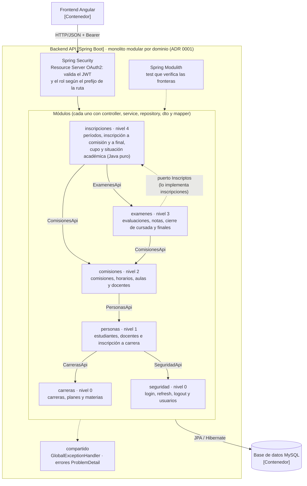
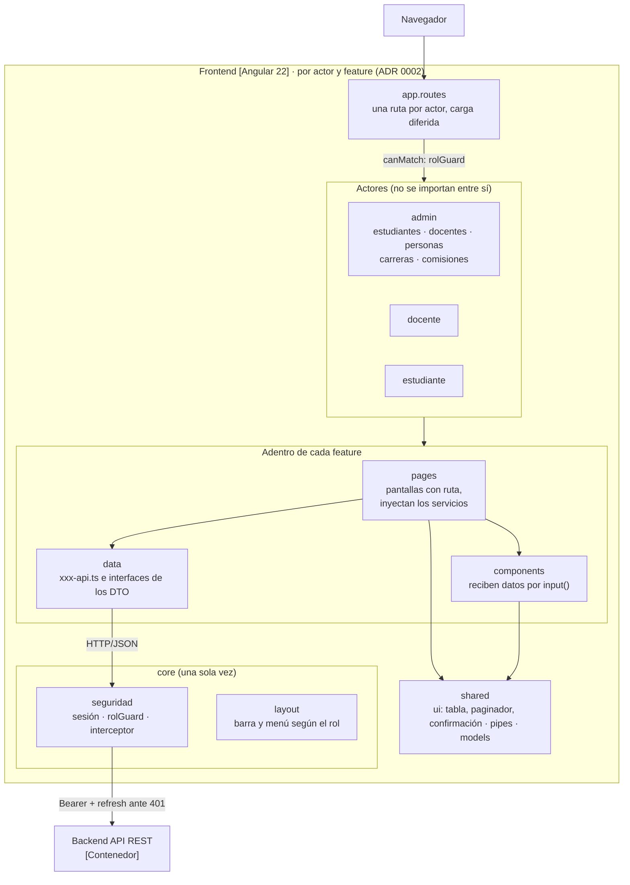

# 3.1.3 Diagrama de componentes: revisión contra el código y los ADR

## Qué no coincide

### Gráfico Nº4 (backend)

| # | El gráfico dice | El código y el ADR 0001 dicen |
|---|---|---|
| 1 | Una arquitectura **por capas** para todo el backend (controllers → services → repositories) | Es un **monolito modular por dominio**: 6 módulos (`seguridad`, `carreras`, `personas`, `comisiones`, `examenes`, `inscripciones`) más `compartido`, y las capas van **adentro** de cada módulo. El ADR 0001 **descarta** "capas por tipo". |
| 2 | "Controllers por rol (Admin / Docente / Estudiante)" | Los controllers están **dentro de cada módulo**, no agrupados por rol. Cada uno atiende un solo prefijo (por ejemplo, `examenes` tiene `ExamenFinalController` para admin, `ExamenFinalDocenteController` para docente y `NotasEstudianteController` para estudiante). El ADR 0001 **descarta** organizar por actor. |
| 3 | No aparecen los módulos ni cómo se comunican | Cada módulo expone una interfaz pública (`CarrerasApi`, `PersonasApi`, `ComisionesApi`, `ExamenesApi`, `SeguridadApi`), solo puede usar módulos de nivel menor, y el ciclo `examenes` ↔ `inscripciones` se corta con el puerto `Inscriptos`. Spring Modulith lo verifica con un test. |
| 4 | "SecurityConfig + filtro JWT" | No hay un filtro propio: es el **Resource Server OAuth2 de Spring Security**, que valida el JWT y lo convierte en `UsuarioPrincipal` (`JwtUsuarioPrincipalConverter`). |
| 5 | "Manejo de excepciones" como componente suelto | Es el `GlobalExceptionHandler` del módulo `compartido`, que responde con **ProblemDetail** (RFC 9457). |
| 6 | Las reglas de negocio están en "Services" | La mayoría sí, pero la situación académica (correlativas y estado de materias) es una clase en **Java puro** en `inscripciones/reglas`, como dice el ADR 0001. |

### Gráfico Nº5 (frontend)

| # | El gráfico dice | El código y el ADR 0002 dicen |
|---|---|---|
| 1 | Organización **por tipo técnico** (pages, components, services, model) | Se organiza **por actor y después por feature** (`admin/`, `docente/`, `estudiante/`, y adentro `estudiantes/`, `comisiones/`…), con `core/`, `shared/` y `login/`. El ADR 0002 **descarta** "por tipo técnico". |
| 2 | "services" y "model" como capas | Dentro de cada feature están en `data/`: un archivo `xxx-api.ts` con las llamadas y las interfaces que copian los DTO. Los tipos comunes están en `shared/models`. |
| 3 | Las pages "usan" los guards | El guard (`rolGuard`) está en `core/seguridad` y lo usa el **router**: protege cada actor con `canMatch` y lo carga de forma diferida. |
| 4 | El interceptor "maneja errores" | El interceptor (`auth-interceptor.ts`) agrega el token y, ante un 401, **renueva la sesión** con el refresh. Los errores de la API los muestra cada página. |
| 5 | No aparecen el layout ni los componentes compartidos | `core/layout` arma la barra y el menú según el rol, y `shared/ui` tiene la tabla, el paginador, la confirmación, la etiqueta y el ícono. |

### Texto de abajo

Dice que "el backend sigue una arquitectura por capas" y describe el frontend por tipo técnico.
Contradice los dos ADR de la sección 3.3 (ahora 3.4), que el profesor va a leer en el mismo documento.

---

## Gráficos corregidos

Pegá cada bloque en https://mermaid.live y exportalo como PNG ("Actions" → "PNG"). Así queda
nítido al 100 %, como pide la consigna.

### Gráfico Nº4: backend

### Gráfico Nº5: frontend

---

## Texto corregido (reemplaza el párrafo de abajo de los gráficos)

El backend es un monolito modular por dominio (ADR 0001). El código se divide en seis módulos de
negocio (seguridad, carreras, personas, comisiones, exámenes e inscripciones) y uno compartido, y
cada módulo tiene adentro sus capas: los controllers reciben las peticiones de un solo prefijo, los
services aplican las reglas de negocio, los repositories acceden a la base y los mappers convierten
entre entidades y DTO. Los módulos se ordenan en niveles y cada uno solo usa a los de nivel menor, a
través de su interfaz pública (por ejemplo, PersonasApi); el ciclo entre exámenes e inscripciones se
corta con el puerto Inscriptos. Un test de Spring Modulith verifica estas fronteras. Antes de los
controllers actúa Spring Security, que valida el token y que el rol corresponda al prefijo de la
ruta, y los errores se devuelven en un formato único (ProblemDetail) desde el módulo compartido.

El frontend se organiza por actor y después por feature (ADR 0002). Cada actor (administrador,
docente y estudiante) tiene una ruta propia, protegida por un guard de rol y cargada solo cuando el
usuario entra a esa sección. Dentro de cada feature, las pages son las pantallas y las únicas que
inyectan servicios, los components muestran partes de la pantalla y la carpeta data contiene las
llamadas a la API y los tipos que copian los DTO. Lo que existe una sola vez (la sesión, el
interceptor que adjunta el token y renueva la sesión, el guard y el menú) está en core, y los
componentes genéricos, como la tabla y el paginador, en shared.
